# 03 — BA/SA: Đặc tả hệ thống trò chuyện HIỆN TẠI + truy vết lỗi + yêu cầu bản mới

> Mọi `file:dòng` trong tài liệu này đọc từ code thật tại thời điểm rà soát.
> Gốc repo: `/home/hoanghuy/Work/BackupData/Freelancer/Game/banh-mi-co-ba`.

---

## 0. Số liệu nền (đếm từ code + content, không phỏng đoán)

| Thứ | Giá trị thật | Đọc ở đâu |
|---|---|---|
| Tổng số cuộc thoại | **86** (không phải "nhiều chục cuộc/người") | 14 file `src/content/talks/*.json` |
| Mỗi NPC có tên | **đúng 6 cuộc / CẢ MÙA 40 NGÀY** | như trên |
| `WALKIN` | 6 cuộc | `walkin.json` |
| `QUA_DUONG` | 8 cuộc | `qua-duong.json` |
| Cuộc có `initiates` | **17/86 (19,8%)** | `initiates` khai trong JSON |
| `initiates` của `WALKIN` | **0** | `walkin.json` |
| `initiates` của `QUA_DUONG` | **0** | `qua-duong.json` |
| `initiates` của `CHU_KIET`, `ANH_BAO` | **0** | 2 file tương ứng |
| Cuộc khai `ignore` riêng | 21/86 — 65 cuộc còn lại ăn `DEFAULT_IGNORE_REL = −1` | `talk.ts:482` |
| Cuộc `npc: "ANY"` | **0** — và `LOADERS` cũng **không có khoá `ANY`** | `talks/index.ts:23-38` |
| `act` trong toàn bộ content | REFUSE 13 · STEP_ASIDE 8 · INVITE 8 · DISCOUNT 6 · PAY 5 · PROMISE 4 · FREE_LOAF 3 | duyệt cây |
| Trần offer | 3 lần/ngày, cách nhau 100 giây thật | `service.ts:83-84` |
| Tầm bấm F | 3 ô | `service.ts:98` |
| Ghim người đi ngang | 4 giây **sim** (đóng băng theo `clock`) | `service.ts:105`, `service.ts:2327` |
| Bong bóng sống | 1,6–4,5 s | `service.ts:286` |
| Toast sống | 2,6–6,0 s, tối đa 3 dòng, cướp dòng già nhất | `Hud.ts:112,125-128,309-310` |

**Hệ quả số học quan trọng nhất:** `pickTalk` rút theo `weight` trên **toàn bộ** kho đủ điều kiện.
Với khách vãng lai (`WALKIN`), xác suất rút trúng `walkin.nhamquan` (câu "Cho tui tô hủ tiếu"):

| Ngày | Cuộc đủ điều kiện (`when`) | Tổng weight | P(nhamquan) |
|---|---|---|---|
| 1–3 | chemac 14 · traigia 11 · nham 12 | 37 | **32,4 %** |
| 4–5 | + donvp 12 | 49 | 24,5 % |
| 6–8 | + cau 13 | 62 | 19,4 % |
| 9–40 | + quayclip 12 | 74 | 16,2 % |

Tức ở ba ngày đầu — đúng quãng người chơi đang học phím — **cứ 3 lần bấm F với khách
vãng lai thì 1 lần ra "Cho tui tô hủ tiếu"**. Đây không phải lỗi hiếm, nó là hành vi
thống kê chủ đạo.

---

## A. MÁY TRẠNG THÁI HIỆN TẠI

### A.1 Sơ đồ

```mermaid
stateDiagram-v2
    direction TB

    [*] --> IDLE

    state "IDLE\n(service.talkSession = null, offer = null)" as IDLE
    state "OFFERED\n(service.offer = {c, talk})\nđồng hồ VẪN CHẠY" as OFFERED
    state "OPEN(depth n)\nTalkSession sống · clock.paused = true" as OPEN
    state "DONE\n(session.done = true)" as DONE
    state "IGNORED\n(applyIgnore đã chạy)" as IGNORED
    state "LEAKED\n(talkSession != null, panel đã đóng)" as LEAKED

    IDLE --> OFFERED : smalltalk(c) [service.ts:1488]<br/>phase=="waiting" && đã gọi món >=4s<br/>&& !queue && !ai đang nói<br/>&& offersToday<3 && now-lastOfferAt>=100s<br/>&& pickTalk(kho.filter(t=>!!t.initiates)) != null<br/>&& derive("talk:day:cid").next() < t.initiates<br/>⇒ say(opener) + out.push(talkOffer)

    IDLE --> OPEN : F → askFront [StallScene:2108]<br/>!handsBusy && !paused && !closed && !panel<br/>→ openTalk() [service.ts:2295]<br/>→ talkTarget() != null<br/>→ talks.has(key)<br/>→ **pickTalk(TOÀN BỘ kho)** [service.ts:2302]<br/>⇒ clock.paused = true

    OFFERED --> OPEN : F → openTalk()<br/>talkTarget() trả về offer.c [service.ts:2438]<br/>dùng LẠI offer.talk, opened=true<br/>⇒ offer = null; KHÔNG nói lại opener

    OFFERED --> IGNORED : leave(c) [service.ts:1615]<br/>khách đi mà chưa ai trả lời<br/>⇒ applyIgnore (rel −1 mặc định)

    OFFERED --> IDLE : openTalk() nhắm người KHÁC<br/>[service.ts:2305 `this.offer = null` VÔ ĐIỀU KIỆN]<br/>⇒ offer bay mất, KHÔNG phạt, KHÔNG đền

    OPEN --> OPEN : chooseTalk(i) [service.ts:2341]<br/>session.choose → depth++ ; here = kids<br/>lần ĐẦU: talkEngaged=true + markTalkUsed()<br/>applyTalkOption: rel/mem/anger/calm/flag/act<br/>cắt ở depth >= MAX_DEPTH(6) [talk.ts:474]

    OPEN --> DONE : r.done (hết `then`/`ref` hoặc chạm MAX_DEPTH)<br/>⇒ endTalk() NGAY [service.ts:2359]<br/>panel vẫn vẽ nhịp cuối để đọc

    OPEN --> IGNORED : Esc / F / (Enter khi count==0) trong panel<br/>[TalkPanel.ts:225] → ignoreTalk [StallScene:2144]<br/>→ closeTalk [service.ts:2367]<br/>CHỈ phạt khi (npcOpened || engaged)

    OPEN --> IDLE : Esc khi CHƯA chọn câu nào và tự mình bấm F<br/>(npcOpened=false, engaged=false)<br/>⇒ KHÔNG phạt, KHÔNG markTalkUsed → **cuộc còn nguyên**

    OPEN --> IGNORED : leave(c) [service.ts:1616 endTalk]<br/>(chỉ xảy ra khi clock chạy — tức không bao giờ<br/>trong lúc panel mở, xem A.3)

    OPEN --> LEAKED : chooseTalk() trả null [StallScene:2136]<br/>panel.destroy() mà KHÔNG gọi service.closeTalk()

    DONE --> IDLE : Enter/Space/Esc đóng panel<br/>closeTalk() thấy s.done ⇒ return, không phạt

    IGNORED --> IDLE : endTalk()
    LEAKED --> DONE : F lần sau → openTalk() trả talkView("")<br/>panel rỗng, done=true

    IDLE --> [*] : hết ngày / dispose()
```



### A.2 Bảng chuyển trạng thái — điều kiện chính xác

| # | Từ | Tới | Trigger | Điều kiện (code) | Ghi chú |
|---|---|---|---|---|---|
| T1 | IDLE | OFFERED | tick NPC | `service.ts:1484-1488` + `2845-2853` | 8 cổng nối tiếp, xem A.4 |
| T2 | IDLE | OPEN | KeyF | `StallScene:988` → `2108` → `service.ts:2295` | **`pickTalk` trên TOÀN BỘ kho** |
| T3 | OFFERED | OPEN | KeyF | `service.ts:2304` `opened = this.offer?.c === c` | không nói lại opener (`2337`) |
| T4 | OPEN | OPEN | 1–4 / ↑↓+Enter / click | `TalkPanel:200-223` → `StallScene:2133` → `service.ts:2341` | |
| T5 | OPEN | DONE | nhánh cạn / MAX_DEPTH | `talk.ts:474`, `service.ts:2359` | `endTalk()` chạy TRƯỚC khi người chơi đọc xong |
| T6 | OPEN | IGNORED | Esc **hoặc F** | `TalkPanel:225` | F vừa mở vừa đóng — xem H-01 |
| T7 | OFFERED | IGNORED | khách đi | `service.ts:1615` | |
| T8 | OFFERED | IDLE | F nhắm người khác | `service.ts:2305` | mất offer, không phạt |
| T9 | OPEN | LEAKED | `chooseTalk` null | `StallScene:2136` | rò state |

### A.3 Cái gì ĐÓNG BĂNG đồng hồ, và đóng băng tới đâu

`openTalkPanel` đặt **`this.clock.paused = true`** (`StallScene.ts:2126`). Không dùng
`pause()` nên không có menu, không `ui:pauseToggled`.

`Clock.advance()` trả **0** khi `paused` (`clock.ts:99`), và `runFrame` **bỏ hẳn 5 bước
input/craft/perception/npc/dialog** khi `dt === 0` (`frame.ts:54`). Nghĩa là mở panel
trò chuyện đóng băng **toàn bộ**:

| Hệ | Đóng băng? | Vì sao |
|---|---|---|
| Kiên nhẫn khách (`waitSec`) | ✅ | bước `npc` không chạy |
| Lò nướng / cháy khét (`oven.tick`) | ✅ | `StallScene:1044` nằm trong `craft` |
| Ổ trên tay nguội (`handWarmth`) | ✅ | `StallScene:1064` |
| Ổ trên thớt / trong rổ / dưới sàn nguội | ✅ | `StallScene:1065,1068,1070` |
| Độ chắc tay (`tickGrip`) | ✅ | `StallScene:1049` |
| Quầy bẩn dần | ✅ | `StallScene:1051,1074` |
| `handsBusy` (lau thớt, rửa tay, ghi sổ) | ✅ | đo bằng `this.elapsed`, chỉ cộng ở bước `perception` (`1077`) |
| Người qua đường đi tiếp / `PASSER_TALK_STAY` | ✅ | `c.now` cộng trong `c.tick` |
| Toast / MoneyPops / `popClock` | ✅ | `StallScene:1224` tự chặn khi `clock.paused` |
| Nhạc nền + ambience | ❌ | `renderPaused` vẫn gọi `syncAudio(0)` |
| Tween Phaser | ❌ | chỉ `pause()` thật mới `tweens.pauseAll()` |

**Kết luận: bảng trò chuyện là một nút "dừng thời gian vô hạn, không giới hạn số lần,
không có chi phí".** Xem H-04.

### A.4 Tám cổng nối tiếp của một lời bắt chuyện tự phát (OFFERED)

1. `c.phase === "waiting"` (đã gọi món, đang chờ bánh) — `service.ts:1484`
2. chưa `smalltalked` lượt này — `1484`
3. đã chờ ≥ `SMALLTALK_AFTER_SEC = 4` giây kể từ lúc gọi món — `1485`
4. hàng đợi thoại rỗng **và** không ai đang nói — `1486`
5. **chưa có `offer` nào khác và không có session nào mở** — `2846` ← khoá TOÀN CỤC
6. `offersToday < 3` và `now − lastOfferAt ≥ 100 s` — `2847-2848`
7. `pickTalk(kho.filter(t => !!t.initiates), ctx)` ≠ null — `2851`
8. `derive("talk:<day>:<cid>").next() < talk.initiates` — `2853`

Với `WALKIN` và `QUA_DUONG`, **cổng 7 luôn trượt** (0 cuộc có `initiates`). Với 12 NPC
có tên, chỉ 17 cuộc qua được cổng 7 — và vì `markTalkUsed` ghi `usedSeason` vĩnh viễn,
17 cuộc đó cạn dần suốt mùa.

### A.5 Ghi `usedToday` / `usedSeason` ở đâu

Chỉ một chỗ: `markTalkUsed` (`service.ts:2550-2555`), gọi từ **đúng một** nơi —
`chooseTalk` dòng `2347`, **chỉ khi `!this.talkEngaged`** (tức ở lần CHỌN CÂU ĐẦU TIÊN).

```
m.talksDone.push(t.id)                 → usedSeason, VĨNH VIỄN cả mùa, vào save (save.ts:62)
m.talkTopics = {day, topics:[t.topic]} → usedToday, reset theo ngày          (save.ts:63)
```

Khoá trí nhớ là `c.memKey`. Với khách lạ và người đi ngang, `memKey = "walkin<style>"`
(`service.ts:1322`) — **8 ô trí nhớ dùng chung cho toàn bộ người lạ của cả mùa**. Xem H-05.

### A.6 Cái gì tính giá (rel / anger / mem / flag / act)

| Đường | Hàm | Dòng | Áp cái gì |
|---|---|---|---|
| Chọn một câu | `applyTalkOption` | `service.ts:2782-2838` | `talkWarmth += rel` → `applyTalk` (rel + mem) → `flag` → `anger×intensityMul` → `waitSec` → `calm` → mặt/dáng → `applyAct` → `STORM_OFF_ANGER` bỏ về → `settleRelMoved` |
| Làm thinh (Esc/F) | `applyIgnore` | `service.ts:2470-2474` | `talk.ignore ?? {rel: −1}` qua đúng `applyTalkOption` |
| Khách đi mà không được trả lời | `leave` | `service.ts:1615` | `applyIgnore` |
| Hành động thật | `applyAct` | `service.ts:2577-2611` | PAY trừ két ngay · DISCOUNT/FREE/PROMISE treo `pledges` · STEP_ASIDE phép thử quan hệ · REFUSE đuổi · INVITE roll |
| Mời khách | `invite` | `service.ts:2626-2650` | `inviteChance` + `derive("invite:<cid>")` — **deterministic theo lượt người đó** |

Khách vãng lai / người đi ngang **không có `c.npc`** ⇒ nhánh `applyTalk` ở `2788` bị bỏ
qua hoàn toàn: **rel và mem với họ không bao giờ được ghi**. Chỉ `anger`, `calm`, `flag`,
`act` là có tác dụng. Nhưng `talkWarmth` vẫn cộng (`2783`) nên "mời khéo" vẫn chạy.

---

## B. BẢNG TRUY VẾT 7 LỖI → NGUYÊN NHÂN GỐC

### B.1 Bảng tổng

| # | Lỗi (chủ dự án báo) | Người chơi THẤY gì | File:dòng gây ra | Nguyên nhân THIẾT KẾ |
|---|---|---|---|---|
| **1** | Switch content quá nhiều | Đang kẹp nhân → bị kéo ra bảng khác → quay lại bảng cũ. Hai modal, hai bộ phím, hai nhịp đọc. | `StallScene.ts:2123-2130` (`openTalkPanel` **park** bảng kẹp nhân rồi `clock.paused = true`) · `StallScene.ts:983` (AssemblyPanel nuốt sạch phím) · `TalkPanel.ts:228` (listener capture nuốt sạch phím còn lại) | **Hội thoại được dựng như một MÀN RIÊNG chứ không như một lớp phủ.** Game có hai modal toàn phần loại trừ nhau; mọi cuộc trò chuyện là một lần chuyển màn. Vi phạm CANON T2 ("món ăn LÀ lựa chọn hội thoại") ngay ở tầng kiến trúc UI: nếu lời nói phải đi qua một modal riêng thì nó không thể là cùng một hành động với việc làm bánh. |
| **2** | Bấm F ra `walkin.nhamquan` ("Cho tui tô hủ tiếu") | Khách đang chờ mua bánh; bấm F; khách gọi hủ tiếu. 32 % số lần ở ngày 1–3. | **`service.ts:2302`** vs **`service.ts:2851`** — xem B.2 | **Thiếu phân loại nội dung theo CHỦ THỂ KHỞI XƯỚNG.** `Talk` chỉ có một trường `initiates` dùng làm *xác suất*, không có trường nào nói "cuộc này **chỉ** NPC được mở". Người viết nội dung không có cách nào khai điều đó. |
| **3** | Bị bắt chuyện lúc đang bán rất phiền | Toast trôi 6 s rồi mất; bong bóng mất sau ≤4,5 s; nhưng hình phạt làm thinh vẫn chờ sẵn. Bấm F thì bị lôi vào modal đóng băng. | `service.ts:2858` + `StallScene.ts:1405-1408` (chỉ một toast, không có trạng thái bền) · `service.ts:286` (bubbleLife ≤4,5 s) · `Hud.ts:112` (3 slot, cướp dòng già) · `service.ts:1615` (phạt khi họ đi) | **Hệ thống có trạng thái bền (`offer`) nhưng chỉ phát ra tín hiệu tức thời.** Không có chỉ báo neo trên người nói, không có mức phản hồi trung gian (gật đầu / ậm ừ) — chỉ có "vào modal" hoặc "ăn phạt". Hai lựa chọn, cả hai đều đắt. |
| **4** | Thiếu NPC ↔ NPC | Cả buổi không thấy hai người nào nói với nhau, trừ 1 cảnh nghe lỏm. | `overhear.ts:16-17` (cửa sổ 8h15–10h30) · `gossip.ts:259` (cảnh chỉ sinh ra khi **đêm trước có truyền tin**) · `gossip.ts:246` (`day < GOSSIP_START_DAY` ⇒ không có) · `GossipCorner.ts:29` (đúng **2 chỗ đứng cố định**) | **NPC-NPC bị định nghĩa là "cửa sổ nhìn vào máy tin đồn", không phải là sự sống của con hẻm.** Nó phụ thuộc ngược vào việc người chơi đã làm gì sai — chơi sạch là con hẻm câm. CANON §16 Đừng-1 bị hiểu nhầm thành "đừng có NPC-NPC", trong khi Orkin nói ngược lại: *vocalizing* là đủ, không cần mô phỏng. |
| **5** | Spam mời khách | Mời hụt → mở lại → mời lại → vẫn "thôi", tốn thời gian thật. | `service.ts:2641` (roll deterministic — đúng, nhưng chỉ chặn *đổi kết quả*) · **không tồn tại cờ nào** chặn mở lại: grep toàn repo không có `invited`/`refusedInvite` · `service.ts:2367-2381` (Esc khi chưa chọn câu ⇒ không phạt, không `markTalkUsed`) | **Chống save-scum được cài ở tầng KẾT QUẢ chứ không ở tầng CƠ HỘI.** Thiết kế giả định "cùng kết quả ⇒ người chơi thôi" — nhưng người chơi không nhìn thấy tính tất định, họ chỉ thấy một cái nút bấm lại được. Thiếu nguyên tắc: *một lời mời là một hành động xã hội, dùng rồi là hết.* |
| **6** | "hết chuyện để nói với abc bữa nay rồi" vô lý | Từ ~ngày 7 trở đi, mọi NPC quen đều trả câu này mọi lúc. | **`service.ts:2391`** (câu chữ) · `service.ts:2545` + `2552` (`usedSeason` = `talksDone`, **vĩnh viễn cả mùa**) · `talk.ts:401` (`!usedSeason.includes(t.id)`) · content: **6 cuộc/NPC/40 ngày** | **Hai lỗi chồng nhau. (a) Câu chữ nói "bữa nay" trong khi state là CẢ MÙA — máy nói dối về phạm vi.** (b) Ngân sách nội dung (6 cuộc) nhỏ hơn số lần người chơi muốn nói chuyện (40 ngày × nhiều lần) một bậc độ lớn. Thiết kế thiếu **tầng thoại tái dùng được** (chào hỏi, câu vu vơ) nằm dưới tầng "cuộc trò chuyện có nội dung". |
| **7** | Nhiều người đứng đó, bấm F không biết nói với ai | Không có vòng chọn, không có mũi tên, không có tên sáng lên. Dòng nhắc thì nói tên người **khác** với người F sẽ nhắm. | `service.ts:2437-2443` (`talkTarget`: offer > gần nhất > front) vs `service.ts:2399-2402` (`nearbyToTalk` **loại `front`**) vs `StallScene.ts:1284-1286` (prompt là ưu tiên **cuối cùng**, sau oven/basket/bin/board) · `CustomerActor.ts:288` (`tag.setVisible(!c.ambient)` — người đi ngang **không có chip tên**) | **Hai hàm khác nhau trả lời hai câu hỏi lẽ ra là một.** Chọn mục tiêu (`talkTarget`) và hiển thị mục tiêu (`nearbyToTalk`) được viết độc lập với luật khác nhau, nên UI không thể đúng. Gốc rễ: chưa coi "ai đang được nhắm" là một **state của world** mà coi nó là kết quả tính lại mỗi lần bấm. |

### B.2 Lỗi #2 — giải thích chính xác, từng dòng

**Hai đường vào, hai bộ lọc khác nhau.**

Đường NPC chủ động (`offerTalk`) — `src/sim/service.ts:2851`:

```ts
const talk = pickTalk(this.talks.get(key).filter((t) => !!t.initiates), this.talkCtx(c), this.dialogRng);
```

Đường người chơi bấm F (`openTalk`) — `src/sim/service.ts:2302`:

```ts
const talk = this.offer?.c === c ? this.offer.talk : pickTalk(this.talks.get(key), this.talkCtx(c), this.dialogRng);
//                                                             ^^^^^^^^^^^^^^^^^^^^^^ KHÔNG có .filter
```

`TalkStore.get()` (`src/content/talks/index.ts:60-62`) trả **nguyên kho của NPC đó**.
`pickTalk` (`src/sim/talk.ts:410-417`) gọi `eligible()` (`talk.ts:398-404`), và `eligible`
chỉ lọc 4 thứ: đúng `npc`, chưa dùng cả mùa, chưa đụng chủ đề hôm nay, và `okWhen`.
**`initiates` không nằm trong `eligible`.** Nó chưa bao giờ là một bộ lọc — nó chỉ là một
con số xác suất mà `offerTalk` tự đọc ở dòng `2853`.

Vì vậy, khi người chơi bấm F với một khách vãng lai, `walkin.nhamquan`
(`src/content/talks/walkin.json:464`, `weight: 12`, không có `when`, không có `initiates`)
**luôn nằm trong rổ rút**, với xác suất 16–32 % tuỳ ngày (bảng ở §0).

**Vì sao `initiates` không chặn được, nói theo thiết kế:**

- `initiates` được định nghĩa (`talk.ts:249-253`) là *"Khách TỰ bắt chuyện: 0..0,6, roll
  khi họ đứng chờ"* — tức là một **xác suất**, không phải một **phân loại**.
- Không có cuộc nào trong 86 cuộc khai được ý "chỉ NPC được mở cuộc này". Mô hình dữ liệu
  `Talk` không có trường đó. Người viết `walkin.nhamquan` muốn nói "đây là câu khách nói
  lúc họ tới", nhưng cái duy nhất họ viết được là `opener` — mà `opener` thì **cả hai
  đường vào đều phát ra** (`service.ts:2337`).
- Và ngay cả nếu `walkin.nhamquan` có khai `initiates: 0.2` thì nó vẫn bị F rút được, vì
  `openTalk` không lọc. Ngược lại: 17 cuộc đang có `initiates` **cũng** bị F rút được.
  Hai tập hoàn toàn chồng nhau, không có cuộc nào bị loại khỏi đường F.
- Gốc rễ nằm ở câu chú thích `talk.ts:245`: *"Bấm F = người chơi gợi chuyện, **khách mở
  lời bằng câu này**"*. Thiết kế **cố ý** để người chơi bấm F rồi NPC nói trước. Với
  `WALKIN` thì đó là mâu thuẫn không cứu được: người chơi chủ động gợi chuyện, mà câu đầu
  tiên lại là một đơn hàng của một quán khác.

**Đóng góp thứ hai, ít ai để ý:** `WALKIN` có **0** cuộc `initiates`. Nên `walkin.nhamquan`
**không bao giờ** đi được đường đúng của nó (NPC tự nói lúc tới). Cách DUY NHẤT để câu đó
xuất hiện trong game hiện tại là người chơi bấm F — tức là 100 % số lần nó xuất hiện đều
là lần sai.

---

## C. DANH MỤC LỖI ẨN (tự tìm, đã verify trong code)

### H-01 — `KeyF` trong `TalkPanel.bindKeys` vừa là phím MỞ vừa là phím ĐÓNG-CÓ-PHẠT
`src/ui/stall/TalkPanel.ts:225`
```ts
if (ev.code === "Escape" || ev.code === "KeyF") { ev.preventDefault(); this.close(); }
```
`close()` → `onClose` → `StallScene.ignoreTalk()` (`2144`) → `service.closeTalk()` → nếu
`npcOpened || engaged` thì **`applyIgnore` phạt rel −1**.
Phản xạ tự nhiên của mọi người chơi là bấm lại phím vừa mở để đóng. Ở đây nó là "làm
thinh với người đang nói chuyện với mình". Hint ở `TalkPanel.ts:142` **không hề nhắc F**:
nó ghi `"1–4 hoặc ↑↓ + Enter · Esc làm thinh"`.
**Nặng hơn:** listener không kiểm `ev.repeat` (so với `StallScene.ts:980` thì có kiểm).
Giữ F quá ~500 ms (ngưỡng auto-repeat của OS) ⇒ panel mở ở frame đầu, repeat tiếp theo
đóng nó kèm phạt. Người chơi không biết mình vừa bị trừ điểm vì **T3 cấm hiện số**.

### H-02 — Thứ tự ưu tiên của Esc: ba hệ thống tranh nhau, và kết quả KHÔNG nhất quán
- `TalkPanel.ts:228` gắn listener **pha CAPTURE trên `window`** và gọi `stopPropagation()`
  ở `199` ⇒ nuốt **toàn bộ** phím, Phaser không thấy gì.
- `StallScene.ts:970-976` (`keydown-ESC` của Phaser): Assembly mở → `park()`; có overlay →
  `overlayBack()`; đang pause → `resume()`; còn lại → `pause()`.
- `AssemblyPanel.ts:556`: Esc → `park()`.

Chuỗi ưu tiên thực tế: **TalkPanel > (Assembly | overlay) > pause**. Hệ quả:
1. **Panel trò chuyện mở ⇒ KHÔNG pause được bằng phím** — vi phạm CANON §15.2
   ("tạm dừng MỌI LÚC"). P, Esc, Tab (sổ tay) đều bị nuốt.
2. Esc mang **ba nghĩa khác nhau** tuỳ ngữ cảnh mà không có gì báo trước: gác ổ (miễn phí) ·
   mở menu (miễn phí) · **làm thinh (mất quan hệ)**. Cùng một phím, một cái có giá.

### H-03 — Nút tạm dừng bằng CHUỘT bỏ qua TalkPanel ⇒ thế giới chạy trong lúc panel còn mở
`Hud.ts:253` đặt vùng bấm pause tại `(512, 26)`, depth `9_000_200`.
TalkPanel ở depth `9_400_000` nhưng **chỉ chiếm phần đáy màn hình** (`TalkPanel.ts:106-107`:
`h ≤ 0.56 × GAME_H`, `cy = GAME_H − h/2 − 10`). Nút pause nằm hoàn toàn ngoài vùng đó ⇒
bấm được.
`StallScene.pause()` (`2539`) **không kiểm `this.talk.isOpen`**. Bấm pause → `paused = true`.
Bấm "tiếp tục" → `resume()` (`2749`) → **`this.clock.paused = false`** trong khi
`this.talk.isOpen === true`.
⇒ Khách tiếp tục mất kiên nhẫn, lò tiếp tục cháy, ổ tiếp tục nguội **trong lúc người chơi
đang đọc bốn dòng thoại** — đúng cái kịch bản mà `talk.ts:26-27` tuyên bố là không bao giờ
được xảy ra. Và vì listener capture vẫn sống, menu pause cũng không nhận được phím.

### H-04 — Panel trò chuyện là nút "dừng giờ" miễn phí, không giới hạn → khai thác được
Xem bảng A.3. Chuỗi khai thác cụ thể, đã verify từng mắt xích:
1. Bỏ 3 ổ vào lò (`oven.tick` sẽ cháy sau N giây).
2. 3 khách đang chờ, `waitSec` sắp chạm `LEAVE_AT`.
3. Bấm F với bất kỳ ai trong 3 ô → `clock.paused = true` (`StallScene:2126`).
4. **Chưa chọn câu nào** → bấm Esc → `closeTalk` thấy `npcOpened=false, engaged=false`
   ⇒ `return` trước `applyIgnore` (`service.ts:2371-2380`). **Không mất gì.**
   `markTalkUsed` cũng chưa chạy ⇒ **cuộc đó chưa bị tiêu**.
5. Lặp bước 3–4 vô hạn.
Chi phí mỗi vòng: đúng 1 frame (~33 ms game-time). Lợi ích: thời gian suy nghĩ vô hạn,
lò không cháy, khách không bỏ đi. Đây đồng thời là **máy reroll nội dung** (xem H-06).

### H-05 — `talksDone` ghi trên `walkin<style>` ⇒ cạn kiệt kho thoại người lạ trong 1–2 ngày
`service.ts:1322` (`memKey = \`walkin${plan.style}\``) và `service.ts:1011` cùng dùng 8 ô
trí nhớ `walkin0..walkin7` cho **mọi** khách vãng lai và **mọi** người đi ngang của cả mùa.
`markTalkUsed` (`2552`) đẩy `t.id` vào `m.talksDone` của ô đó, `talkCtx` (`2545`) đọc lại
làm `usedSeason`, `eligible` (`talk.ts:401`) loại vĩnh viễn.
- `QUA_DUONG`: 8 cuộc × 8 dáng = **64 cuộc cho cả mùa 40 ngày**. Người đi ngang spawn mỗi
  2,6–18 giây thật (`passersby.ts:57`). Chơi tích cực là cạn trong **buổi sáng đầu tiên**.
- `WALKIN`: 6 cuộc × 8 dáng = **48 cuộc cho cả mùa**.
Sau đó mọi người lạ đều trả `"hết chuyện để nói với bà cụ bữa nay rồi"` — **suốt 39 ngày
còn lại**, và câu đó ghi "bữa nay". Đây là nhiên liệu chính của lỗi #6, nặng hơn cả 12 NPC
có tên.

### H-06 — Esc-trước-khi-chọn = máy reroll nội dung, phá chính cơ chế chống save-scum
`openTalk` (`2302`) rút bằng `this.dialogRng` — stream `dialog-shufflebag` tiến một bước
mỗi lần rút. `closeTalk` không ghi gì nếu chưa chọn câu (`2371`). Nên F→Esc→F→Esc rút
**các cuộc khác nhau**, miễn phí, trong thời gian đóng băng.
Người chơi muốn tránh `walkin.nhamquan` chỉ cần Esc rồi bấm lại. Người chơi muốn tìm đúng
cuộc có nút `INVITE` cũng vậy. `CANON §8 chống save-scum` được bảo vệ ở `invite:<id>`
(`2641`) nhưng bị bỏ ngỏ hoàn toàn ở tầng **chọn cuộc nào**.

### H-07 — `offer` chỉ có MỘT slot toàn cục, và `smalltalked` bị tiêu trước khi biết kết quả
`service.ts:2846`: `if (this.offer || this.talkSession) return false;`
`service.ts:1487-1488`:
```ts
this.smalltalked.add(c.id);        // ← đánh dấu TRƯỚC
if (this.offerTalk(c)) return;     // ← rồi mới thử
```
Khách B muốn bắt chuyện trong lúc offer của khách A còn treo ⇒ `offerTalk` trả `false`
nhưng `c.id` **đã bị đánh dấu `smalltalked`** ⇒ B **không bao giờ** có cơ hội thứ hai
trong cả lượt ghé. Ba khách cùng chờ thì hai người vĩnh viễn im. Thêm vào đó, khoá
`this.talkSession` nghĩa là chỉ cần người chơi đang mở panel với ai đó là mọi lời bắt
chuyện khác bị huỷ (không hoãn).

### H-08 — `openTalk` xoá `this.offer` VÔ ĐIỀU KIỆN
`service.ts:2305`: `this.offer = null;` — nằm ngoài mọi nhánh `if`.
Chạy ngay cả khi `talkTarget()` trả về một người **khác** `offer.c`. Lúc đó:
- lời mời của A biến mất, không `applyIgnore` ⇒ **không phạt**, và khi A đi,
  `service.ts:1615` kiểm `this.offer?.c === c` → đã null ⇒ cũng không phạt;
- `markTalkUsed` chưa chạy ⇒ cuộc của A chưa bị tiêu.
Tức "làm thinh có giá" có một lỗ thoát: cứ bấm F với người khác là xoá nợ.

**Mặt trái của cùng một dòng code:** `talkTarget()` (`2438`) ưu tiên `offer.c` **tuyệt
đối**. Nên trong lúc A còn treo offer, người chơi **không thể** bấm F để nói với ai khác —
kể cả người đi ngang đang đứng ngay trước mặt, kể cả khi `promptLine` (`StallScene:1285`)
đang hiện chữ `"F — nói chuyện với anh chạy xe"`. **Dòng nhắc nói sai tên người.**

### H-09 — `nearbyToTalk()` loại `front`, và prompt trò chuyện là ưu tiên CUỐI CÙNG
`service.ts:2399-2402`: `return c && c !== this.front ? c : null;`
`StallScene.ts:1284-1286`: dòng `F — nói chuyện với X` nằm **sau** `pendingDebt`, finale,
`handsBusy`, phím C, đồ dưới sàn, oven, basket, bin, board.
Hệ quả đo được:
- Đứng đúng chỗ đưa hàng, trước mặt khách đầu quầy ⇒ **không có một dòng nhắc nào** nói
  rằng F sẽ nói chuyện với người đó. Đây là trường hợp **thường gặp nhất** trong game.
- Đứng cạnh lò / thớt / kệ (tức gần như mọi lúc đang làm việc) ⇒ prompt trạm thắng, dòng
  trò chuyện bị nuốt kể cả khi có người trong tầm.
- Khi dòng đó hiện ra thì nó có thể nói sai tên (H-08).

### H-10 — `talkable()` cho phép bắt chuyện với người đang `arriving` giữa đường
`service.ts:2413-2416`:
```ts
private talkable(c: Customer) {
  if (c.balking) return false;
  return c.pass ? true : c.phase !== "leaving";
}
```
`arriving` và `queueing` đều lọt. Người chơi có thể chạy ra cổng, bấm F với một người đang
đi vào quầy, kéo họ vào một cây thoại 6 tầng — trong lúc đó `clock.paused` nên họ đứng
hình giữa hẻm. Đóng panel xong họ "nhảy" tiếp quãng đường còn lại. Tệ hơn: `openTalk`
(`2325-2328`) **chỉ ghim `pass`**, không ghim người đang `arriving`.

### H-11 — Người đi ngang bị ghim 4 giây, nhưng cái 4 giây đó đo bằng thời gian ĐÃ ĐÓNG BĂNG
`service.ts:105` `PASSER_TALK_STAY = 4`; `service.ts:2327` `c.pass.until = c.now + 4`.
`c.now` chỉ tăng trong `c.tick(dt)` ở bước `npc`, mà bước đó bị bỏ khi `dt === 0`.
⇒ Cả cuộc thoại 6 tầng tiêu **0 giây** của quỹ 4 giây. Đồng hồ 4 giây chỉ bắt đầu chạy
**sau khi** panel đóng. Nghe thì có vẻ "may", nhưng nó tạo hai lỗi đọc được:
1. Người đi ngang đứng **bất động tuyệt đối** suốt cuộc thoại rồi đột ngột bước đi — không
   có nhịp "chào rồi đi".
2. Nếu người chơi mở panel, Esc, mở lại (H-04/H-06), `until` bị **đặt lại 4 giây mỗi lần**
   ⇒ giữ một người đi ngang đứng tại chỗ **vô hạn**.
3. Ngược lại, nếu người chơi đóng panel rồi lưỡng lự 5 giây, người kia đi mất giữa lúc
   mình định bấm F lần hai — và `talksDone` đã ghi, cuộc đó mất luôn cả mùa (H-05).

### H-12 — `TalkStore.release()` đếm bằng `Set`, không đếm tham chiếu ⇒ kho bị thả khi vẫn còn người
`talks/index.ts:87-94`:
```ts
release(npcId) { if (!this.live.delete(npcId)) return; this.recent.push(npcId); ... }
```
`live` là `Set<string>`. Năm khách vãng lai cùng lúc đều `ensure("WALKIN")` → **một** phần
tử trong Set. Người đầu tiên rời (`service.ts:1678`) → `live.delete("WALKIN")` → "WALKIN"
vào LRU `recent` dù **bốn người còn đứng đó**. `KEEP_RECENT = 4`, mà người đi ngang +
khách lạ ra vào liên tục ⇒ `loaded.delete("WALKIN")` xảy ra thật.
Lúc đó bấm F → `service.ts:2301` `!this.talks.has(key)` → trả `null` → `talkUnavailable()`
(`2390`) trả **`"…"`**. Người chơi thấy một dấu ba chấm không nghĩa lý gì, phím như hỏng.

### H-13 — Khách vừa nhận lời mời không có kho thoại ⇒ F lần sau trả `"…"`
`acceptInvite` (`service.ts:2661-2676`) đặt `c.ambient = false; c.pass = null` ⇒
`talkKey(c)` (`2531`) đổi từ `"QUA_DUONG"` sang `"WALKIN"`. Nhưng hàm **không gọi**
`this.talks.ensure("WALKIN")`. Nếu chưa có khách vãng lai nào hôm nay (đúng tình huống
"quán vắng nên ra mời"), `WALKIN` chưa được nạp ⇒ F với người mình vừa mời được trả `"…"`.

### H-14 — `visibleOptions` bỏ qua chính cái cổng nó vừa dựng
`talk.ts:426-431`:
```ts
const out = nodes.filter(...need & needCash...);
return out.length ? out : nodes.slice(0, 1);
```
Lọc sạch thì **trả về nút thứ nhất bất kể nó có qua cổng hay không**. Nút đó có thể là
nút `needCash` (hứa mua vé số 10.000₫) hoặc nút `need` một cờ chuyện chưa bật. Hệ quả:
`applyAct` PAY chạy với `Math.min(act.vnd, have)` (`service.ts:2584`) ⇒ người chơi **hứa
trả 10.000₫ mà chỉ trả được 2.000₫**, và câu `reply` viết sẵn vẫn cảm ơn đủ số.
Vi phạm chính chú thích ở `talk.ts:200`: *"không hứa được cái mình không trả nổi"*.

### H-15 — Rò session: `chooseTalk` trả `null` thì panel đóng mà `talkSession` còn sống
`StallScene.ts:2136`: `if (!next) { this.closeTalkPanel(); return; }` — **không gọi**
`this.service.closeTalk()`. `closeTalkPanel` (`2150`) chỉ `talk.destroy()` + thả `clock`.
⇒ `service.talkSession !== null` mãi mãi ⇒ `offerTalk` (`2846`) **bị khoá vĩnh viễn phần
còn lại của ngày**: không khách nào bắt chuyện được nữa. Và F lần sau rơi vào nhánh
`openTalk:2296` `if (this.talkSession) return this.talkView("")` ⇒ panel rỗng, không câu
nói, không lựa chọn, chỉ có `"Enter — thôi nói chuyện"`.

### H-16 — Nhật ký hội thoại bị chính bảng hội thoại che
`chooseTalk` đẩy `con: "<câu vừa nói>"` và `<tên>: "<câu đáp>"` vào `out` (`2348`, `2355`);
`StallScene.pickTalk:2135` route chúng qua `routeLine` → `hud.say` → `feedText` tại
`(26, GAME_H − 100) = (26, 476)`, depth `9_000_100` (`Hud.ts:232-235`).
TalkPanel cao tới `0.56 × 576 = 322 px`, đáy sát `GAME_H`, depth `9_400_000`
(`TalkPanel.ts:90,106-107`) ⇒ **phủ kín vùng 244–566 px**, tức nuốt trọn khung nhật ký.
Người chơi không bao giờ thấy nhật ký trong lúc nói chuyện; đóng panel xong thì thấy ba
dòng lặp lại nguyên văn thứ vừa đọc.

### H-17 — `talkOffer` không tới được người chơi nếu họ đang mở bảng kẹp nhân
Hai tầng chặn độc lập:
- **Thấy:** toast nằm ở góc **phải trên** (`Hud.ts:108` `TOAST_RIGHT = GAME_W − 26`,
  `TOAST_TOP = 150`), AssemblyPanel nằm bên **trái** (`PANEL_LEFT = 8`, rộng 470) ⇒ toast
  vẫn thấy. Nhưng nó sống tối đa **6 giây** và chỉ có 3 slot bị cướp liên tục (`Hud.ts:309`).
- **Làm:** `StallScene.ts:983`
  ```ts
  if (this.assembly.isOpen) { this.assembly.handleKey(ev.code); return; }
  ```
  `return` **bất kể** `handleKey` trả gì. `AssemblyPanel.handleKey` (`546-558`) không xử
  `KeyF` → trả `false` → nhưng phím đã bị nuốt. ⇒ Toast bảo *"bấm F để trả lời"* mà **F
  hoàn toàn chết** suốt thời gian kẹp nhân.
Cộng thêm `askFront:2109` `if (this.handsBusy ...) return;` — bấm F lúc đang lau thớt/rửa
tay/ghi sổ cũng **im lặng tuyệt đối**, không toast, không log. Ba đường, cả ba đều câm.

### H-18 — Xung đột `ASK_COOLDOWN` ↔ mở panel: cuộc thoại thứ hai không có ai ngẩng mặt lên
`service.ts:2332-2335`:
```ts
if (c.now - c.lastAskedAt >= ASK_COOLDOWN) {
  c.ask();
  this.deps.bus.emit("attention:toolUsed", { tool: "ASK_QUESTION", npcId: c.memKey, durationSec: 3 });
}
```
`ASK_COOLDOWN = 60` (`service.ts:283`) **giây sim**, mà `c.now` đóng băng trong lúc panel
mở (A.3). Cuộc thoại thứ hai với cùng một người trong vòng 60 giây sim — chuyện xảy ra
liên tục vì panel không tiêu thời gian — **không gọi `c.ask()`**: khách không ngẩng lên,
không nhìn mặt, không phát `attention:toolUsed`. Người chơi thấy mình nói chuyện với một
người đang nhìn chỗ khác. Đây là lỗi làm hỏng đúng trụ cột "a game about being watched".

### H-19 — Hành động `REFUSE` / `anger ≥ STORM_OFF_ANGER` chạy được trên người đi ngang
`applyTalkOption:2832` gọi `this.leave(c, "insulted")`; `applyAct` case `"REFUSE"` (`2603`)
gọi `this.leave(c, "refused")`. Cả hai không kiểm `c.ambient`. `leave()` trên một người đi
ngang: đặt `c.slot = -1`, `c.zone = "SEATED_FAR"`, bắn `npc:left`, và **gọi
`this.talks.release("QUA_DUONG")`** (`1678`) — kích hoạt H-12 trên kho người đi ngang,
dù năm người khác vẫn đang đi trên đường. Log ra `"<tên> bị mời đi."` về một người **chưa
hề xin mua gì**.

### H-20 — `ANY` là mã chết; `TalkStore.clear()` giữ một thứ không tồn tại
`talk.ts:400` (`t.npc === "ANY"`), `talks/index.ts:61` (`...this.loaded.get("ANY")`),
`talks/index.ts:97-103` (`clear()` cố giữ `ANY`). Nhưng `LOADERS` (`index.ts:23-38`)
**không có khoá `ANY`**, và đếm content cho thấy **0 cuộc nào khai `npc: "ANY"`**.
Tức "cuộc dùng chung ai cũng nói được" — đúng cái lớp nội dung tái dùng mà lỗi #6 đang
thiếu — đã được dựng sẵn khung và **chưa bao giờ được nối dây**.

### H-21 — Không có cờ nào chặn mời lại (xác nhận cho lỗi #5)
Grep toàn repo: không tồn tại `invited`, `inviteDone`, `refusedInvite` hay bất kỳ cờ nào.
`invite()` (`2626`) chạy lại từ đầu mỗi lần. Tính tất định của `derive("invite:<c.id>")`
chỉ đảm bảo **kết quả** không đổi, không đảm bảo **cơ hội** không lặp. Và vì cuộc thoại
chứa `INVITE` có thể được rút lại (H-06) hoặc chứa **hai** nút `INVITE` trong cùng cây
(`duong.nang`, `duong.ngo` — xem dump §0), người chơi gặp đúng câu "thôi" nhiều lần trong
một cuộc.

### H-22 — `nearestTalkable` không có đường ngắm, xuyên tường và xuyên quầy
`service.ts:2419-2429` chỉ dùng `Math.hypot`. Mặt quầy, xe bánh mì, cột — không cái nào
chắn. Đứng trong quán bấm F có thể bắt chuyện với một người đi ngang **phía bên kia cái
xe** gần hơn khách đang đứng chờ trước mặt, và người chơi không có cách nào biết trước.

---

## D. YÊU CẦU CHỨC NĂNG CHO BẢN MỚI

Quy ước: mỗi dòng là **một mệnh đề kiểm chứng được**. Cột *Đóng* ghi lỗi mà yêu cầu đó
khoá lại (số = lỗi chủ dự án báo, H-xx = lỗi ẩn).

### D.1 Phân loại nội dung & quyền khởi xướng

| ID | Yêu cầu | Đóng |
|---|---|---|
| **FR-01** | Mỗi `Talk` phải khai một trường bắt buộc `source: "NPC_ONLY" \| "PLAYER_ONLY" \| "BOTH"`; build fail nếu thiếu. | 2 |
| **FR-02** | Khi người chơi mở hội thoại chủ động, hệ thống **phải** rút từ tập đã lọc `source !== "NPC_ONLY"`; không một đường code nào được gọi `pickTalk` trên kho chưa lọc. | 2, H-06 |
| **FR-03** | Khi NPC tự mở lời, hệ thống **phải** rút từ tập đã lọc `source !== "PLAYER_ONLY" && initiates > 0`. | 2 |
| **FR-04** | `walkin.nhamquan` và mọi cuộc có `opener` là một **đơn hàng, một yêu cầu hoặc một câu nhầm lẫn** phải được đánh `source: "NPC_ONLY"`; test nội dung phải quét `opener` tìm dấu hiệu đơn hàng ("cho tui", "cho con", "lấy cho") và fail nếu cuộc đó không phải `NPC_ONLY`. | 2 |
| **FR-05** | Khi khách vãng lai tới quầy và cuộc `NPC_ONLY` của họ trúng điều kiện, hệ thống **phải** để chính NPC phát câu đó lúc họ tới — không chờ người chơi bấm phím nào. | 2, 3 |
| **FR-06** | Khi kho thoại "có nội dung" của một người đã cạn, hệ thống **phải** rơi về một **tầng thoại tái dùng** (chào hỏi / câu vu vơ / nhận xét theo bối cảnh) thay vì trả lỗi; tầng này không bao giờ cạn. | 6, H-05, H-20 |
| **FR-07** | Khi thật sự không còn gì để nói, câu báo **phải** đúng phạm vi state: nếu khoá theo mùa thì không được ghi "bữa nay". Câu chuẩn: `"<tên> không muốn nói chuyện lúc này"`. | 6 |
| **FR-08** | `usedSeason` của khách lạ và người đi ngang **phải** được khoá theo **lượt ghé** (`customer.id`), không theo `walkin<style>`; chỉ 12 NPC có tên mới dùng khoá theo mùa. | 6, H-05 |

### D.2 Hội thoại không được cướp quyền điều khiển

| ID | Yêu cầu | Đóng |
|---|---|---|
| **FR-09** | Khi NPC nói một câu bất kỳ, hành vi mặc định **phải** là bong bóng tại chỗ — hệ thống không bao giờ tự mở bảng lựa chọn. | 1, 3 |
| **FR-10** | Khi một câu nói của NPC có thể được đáp lại, hệ thống **phải** neo một **chỉ báo bền trên đầu người đó** (không phải toast) và chỉ báo đó phải tồn tại đúng bằng khoảng thời gian lời đáp còn có giá trị. | 3, 7, H-07 |
| **FR-11** | Khi người chơi đang giữ ổ nóng, đang trong `handsBusy`, hoặc bảng kẹp nhân đang mở, hệ thống **phải** cho phép bấm phím đáp và **hoãn** việc mở giao diện cho tới khi tay rảnh — không được nuốt phím im lặng. | 1, 3, H-17 |
| **FR-12** | Khi người chơi bấm phím đáp mà hành động không thực hiện được, hệ thống **phải** phát đúng một dòng nói rõ lý do; không bao giờ im lặng tuyệt đối. | H-17 |
| **FR-13** | Bảng lựa chọn (nếu còn giữ) **phải** chỉ mở khi người chơi chủ động yêu cầu đọc lựa chọn, và **phải** đóng được bằng một phím **không có giá**, tách bạch với phím "làm thinh có giá". | 1, H-01, H-02 |
| **FR-14** | Phím mở hội thoại và phím đóng hội thoại **phải khác nhau**; không phím nào vừa mở vừa đóng. | H-01 |
| **FR-15** | Mọi handler phím của hội thoại **phải** bỏ qua `ev.repeat`. | H-01 |

### D.3 Thời gian, pause và tính công bằng

| ID | Yêu cầu | Đóng |
|---|---|---|
| **FR-16** | Khi giao diện hội thoại mở, hệ thống **phải** đóng băng `clock`, và **phải** vẫn cho người chơi mở menu tạm dừng (CANON §15.2) bằng cả phím lẫn chuột. | H-02, H-03 |
| **FR-17** | Khi menu tạm dừng đóng lại trong lúc giao diện hội thoại còn mở, hệ thống **phải** giữ `clock.paused = true`; chỉ việc đóng hội thoại mới được thả đồng hồ. | H-03 |
| **FR-18** | Mở rồi đóng giao diện hội thoại **phải** tiêu một lượng thời gian game tối thiểu khác 0 (hoặc bị giới hạn số lần mỗi lượt khách), để nó không còn là nút dừng giờ miễn phí. | H-04 |
| **FR-19** | Khi người chơi mở một cuộc và thoát ra, hệ thống **phải** ghi nhớ **đúng cuộc đó** cho lần mở tiếp theo với cùng người trong cùng lượt ghé — không rút lại. | H-06 |
| **FR-20** | Khi người chơi bắt chuyện với một người đi ngang, hệ thống **phải** ghim họ lại bằng thời gian **thật của cuộc trò chuyện** (tính cả thời gian đóng băng), và **không** được gia hạn khi mở lại. | H-11 |

### D.4 Mục tiêu, chỉ báo, nhiều người cùng lúc

| ID | Yêu cầu | Đóng |
|---|---|---|
| **FR-21** | Hệ thống **phải** duy trì một state `talkTarget` công khai, tính một lần mỗi frame; mọi UI chỉ báo và mọi hành động bấm phím **phải** đọc cùng state đó. | 7, H-08, H-09 |
| **FR-22** | Khi có ≥1 người nói chuyện được trong tầm, hệ thống **phải** làm nổi bật **đúng người sẽ được nhắm**, kể cả khi đó là người đứng đầu quầy và kể cả khi dòng nhắc trạm đang chiếm chỗ. | 7, H-09 |
| **FR-23** | Khi có ≥2 người nói chuyện được trong tầm, hệ thống **phải** cho người chơi **đổi mục tiêu** bằng một thao tác rõ ràng trước khi bắt chuyện. | 7 |
| **FR-24** | Người đi ngang đang là mục tiêu **phải** hiện danh xưng của họ (hiện tại `CustomerActor.ts:288` ẩn hoàn toàn). | 7 |
| **FR-25** | Hệ thống **phải** giữ được **nhiều lời bắt chuyện đang treo cùng lúc** (hàng đợi, không phải một slot); mỗi lời treo có chỉ báo riêng và thời hạn riêng. | 3, H-07 |
| **FR-26** | Một khách bị trượt lời bắt chuyện vì lý do kỹ thuật (có người khác đang treo) **phải** được thử lại, không bị đánh dấu "đã dùng lượt". | H-07 |
| **FR-27** | Trả lời người này **không** được âm thầm huỷ lời bắt chuyện của người kia; nếu bị huỷ thì phải áp đúng hậu quả của việc làm thinh. | H-08 |
| **FR-28** | Mục tiêu hội thoại **phải** bị loại nếu bị vật cản che (quầy, xe), và **phải** loại người đang `arriving` chưa vào tới chỗ đứng. | H-10, H-22 |

### D.5 NPC ↔ NPC

| ID | Yêu cầu | Đóng |
|---|---|---|
| **FR-29** | Hệ thống **phải** sinh được các cảnh NPC-NPC **không phụ thuộc** vào việc có tin đồn hay không: hai người đi ngang gặp nhau chào một câu rồi đi là một cảnh hợp lệ. | 4 |
| **FR-30** | Cảnh NPC-NPC **phải** xảy ra được ở bất kỳ chỗ nào hai người gặp nhau trên đường, không chỉ ở hai ô cố định `GOSSIP_CORNER`. | 4 |
| **FR-31** | Cảnh NPC-NPC **phải** không tạo nghĩa vụ nào cho người chơi: không chỉ báo, không hình phạt bỏ qua, nghe được thì nghe. | 4, CANON §16 Đừng-1 |
| **FR-32** | Mật độ cảnh NPC-NPC **phải** cấu hình được và mặc định không vượt quá mức khiến người chơi bỏ sót việc ở quầy (đo: không quá 1 cảnh / 90 giây thật). | 1, 4 |

### D.6 Mời khách, hành động, toàn vẹn state

| ID | Yêu cầu | Đóng |
|---|---|---|
| **FR-33** | Khi một người đi ngang đã từ chối lời mời, hệ thống **phải** đặt một cờ trên lượt đi ngang đó khiến mọi lựa chọn `INVITE` sau đó **bị ẩn**, không phải bị roll lại. | 5, H-21 |
| **FR-34** | Hệ thống **phải** giới hạn mỗi lượt đi ngang **tối đa một lời mời**, và phải nói rõ bằng văn bản/trạng thái rằng cơ hội đã dùng. | 5 |
| **FR-35** | `visibleOptions` **phải** không bao giờ hiện một lựa chọn không qua `need`/`needCash`; nếu lọc sạch thì phải chèn một đường ra trung tính khai sẵn trong cuộc, không lấy `nodes[0]`. | H-14 |
| **FR-36** | Mỗi đường đóng giao diện hội thoại **phải** đi qua đúng một hàm kết thúc phiên; không đường nào được `destroy()` UI mà bỏ qua `closeTalk()`. | H-15 |
| **FR-37** | Khi khách nhận lời mời, hệ thống **phải** nạp xong kho thoại vai mới của họ trước khi cho phép bắt chuyện lại. | H-13 |
| **FR-38** | `TalkStore` **phải** đếm tham chiếu (số người đang dùng kho), không dùng `Set`; kho chỉ được thả khi số tham chiếu về 0. | H-12 |
| **FR-39** | `REFUSE` và ngưỡng bỏ-về-vì-bị-chửi **phải** không áp dụng cho người đi ngang; với họ hậu quả phải là "đi tiếp", không phải "bị mời đi". | H-19 |
| **FR-40** | Nhật ký hội thoại **phải** không bị giao diện hội thoại che; hoặc đổi chỗ, hoặc không ghi trùng thứ đang hiện trên bảng. | H-16 |

### D.7 Phi chức năng

| ID | Yêu cầu | Đóng |
|---|---|---|
| **NFR-01** | Không một con số quan hệ / giận / điểm nào được hiện ra ở bất kỳ kênh nào của hệ trò chuyện (CANON T3). | — |
| **NFR-02** | Mọi hậu quả có giá của một thao tác **phải đọc được trước khi bấm** (CANON T5): phím "làm thinh" phải được ghi rõ là có giá ở ngay chỗ nó được dùng. | H-01, H-02 |
| **NFR-03** | Mọi thao tác hội thoại **phải** làm được bằng cả bàn phím, chuột và chạm (CANON §15.5). | — |
| **NFR-04** | Hệ trò chuyện **phải** tôn trọng chế độ không giới hạn thời gian: không câu thoại nào tự trôi mất, không chỉ báo nào hết hạn theo đồng hồ (CANON §15.2). | 3, H-07 |
| **NFR-05** | Mọi roll liên quan tới hội thoại **phải** tất định theo `(saveId, ngày, id lượt ghé)` và **phải không** lặp lại được bằng cách đóng/mở giao diện (CANON §8). | H-04, H-06 |
| **NFR-06** | Kho thoại **phải** đủ cho 40 ngày: với mỗi NPC, số cuộc khả dụng ≥ số lượt ghé dự kiến × tỉ lệ bắt chuyện; test content phải fail nếu một NPC cạn trước ngày 40. | 6, H-05 |
| **NFR-07** | Mô hình dữ liệu `Talk` **phải** không còn trường chết: `ANY` phải được nối dây hoặc gỡ bỏ. | H-20 |
| **NFR-08** | Hệ trò chuyện mới **phải** chạy headless (`npm run sim`) để test được toàn bộ máy trạng thái ở §A mà không cần Phaser. | — |

---

## E. MA TRẬN XUNG ĐỘT

**Hàng** = người chơi đang làm gì. **Cột** = loại sự kiện hội thoại.
**Ô** = hành vi ĐÚNG mà hệ thống phải làm.

Ký hiệu ô: `im` · `bb` bong bóng · `bb+cb` bong bóng + chỉ báo đáp được · `panel` mở giao
diện lựa chọn · `hoãn` xếp hàng, phát khi tay rảnh · `bỏ` bỏ hẳn sự kiện.

| Người chơi đang… | NPC chào | NPC hỏi mua (gọi món) | NPC bắt chuyện dài | NPC ↔ NPC tán gẫu | Người qua đường |
|---|---|---|---|---|---|
| **Đang kẹp nhân** (AssemblyPanel mở) | `bb` | `bb` **(không bao giờ hoãn — đơn hàng là dữ liệu bắt buộc)** | `hoãn` | `bb` (ngoài khung bảng) | `bỏ` |
| **Đang nướng** (đứng ở lò, thao tác lò) | `bb` | `bb` | `bb+cb` | `bb` | `im` |
| **Tay cầm ổ nóng** (trục nguội đang chạy) | `bb` | `bb` | `hoãn` | `bb` | `bỏ` |
| **Đang rửa tay / lau thớt** (`handsBusy`) | `bb` | `bb` | `hoãn` | `bb` | `bỏ` |
| **Đang ghi sổ** (`G`, 2 s tay) | `bb` | `bb` | `hoãn` | `im` | `bỏ` |
| **Đang rảnh** (tay không, không ở trạm) | `bb+cb` | `bb+cb` | `bb+cb` → `panel` nếu người chơi bấm đáp | `bb` | `bb+cb` |
| **Đang có 3 khách chờ** (hàng đầy) | `bb` | `bb` | `bỏ` **(không mở lời bắt chuyện dài khi hàng đầy)** | `im` | `bỏ` |

### E.1 Luật đọc ma trận

1. **Không ô nào là `panel` tự động.** `panel` chỉ xuất hiện ở hàng "đang rảnh" và chỉ sau
   một hành động chủ động của người chơi. Đây là cách đóng lỗi #1 và #3 cùng lúc.
2. **Cột "NPC hỏi mua" không bao giờ `hoãn`.** Đơn hàng là dữ liệu người chơi **bắt buộc**
   phải nghe (CANON T2 — không có checklist). Hoãn nó là làm hỏng vòng lặp lõi.
3. **`hoãn` phải có thời hạn và phải nổ ra.** Một sự kiện bị hoãn mà không bao giờ phát là
   `bỏ` trá hình — và nó đẻ ra đúng cái bẫy "bị phạt vì thứ mình không thấy" của H-07.
4. **`bỏ` ≠ `im`.** `bỏ` = sự kiện không được sinh ra (tiết kiệm sự chú ý của người chơi).
   `im` = sự kiện xảy ra ở thế giới nhưng không có kênh nào báo (NPC vẫn nói với nhau,
   người chơi đang cắm mặt vào lò thì không nghe thấy — đúng tinh thần ba tầng nghe lỏm
   của `overhear.ts`).
5. **"3 khách chờ" là trạng thái chặn mạnh nhất.** Nó ăn khớp sẵn với `inviteChance`
   (`passersby.ts:203`: `ahead >= slots ⇒ 0`) — nên luật này không phải phát minh mới,
   nó là mở rộng một luật đã có ra toàn hệ.
6. **Hàng "đang nướng" được `bb+cb` ở cột bắt chuyện dài** vì đứng ở lò là lúc tay rảnh
   nhất trong các trạng thái bận: `oven` chạy nền, người chơi chỉ đang chờ.

---

## F. CÂU HỎI GỐC: GIỮ, THU NHỎ, HAY BỎ CÂY THOẠI?

Đây là câu BA phải trả lời thẳng, không phải khuyến nghị thiết kế — chỉ là hệ quả của
những gì đo được ở trên.

**Dữ kiện:**
- CANON T2 nguyên văn: *"Không có dialogue tree. Người chơi không bao giờ chọn câu nói."*
- Code hiện tại: `MAX_DEPTH = 6`, 86 cây, panel modal chọn câu. **Vi phạm trực tiếp.**
- Nhưng 12.600 dòng JSON **không phải** đều là "câu người chơi chọn": theo `linesOf`
  (`talk.ts:538-544`), mỗi cuộc có `opener` + `reply` của mỗi nút (**lời NPC**) và `say`
  của mỗi nút (**lời người chơi**). Lời NPC là phần **không vi phạm T2** và là phần đắt
  nhất để viết.
- Lỗi #1 (switch content) và #3 (phiền) **đều** truy ngược về cùng một dòng:
  `StallScene.ts:2126` `this.clock.paused = true` + `TalkPanel` modal. Không phải về nội dung.

**Kết luận BA:** vấn đề không nằm ở 12.600 dòng, nó nằm ở **cái panel modal đóng băng thế
giới**. Mọi phương án giữ được phần `opener`/`reply` (lời NPC) và chuyển phần `say` (lời
người chơi) sang một kênh **không modal, không đóng băng, không bắt đọc** đều cứu được cả
ba lỗi #1, #2, #3 mà không vứt nội dung. Lựa chọn giữa các phương án đó là việc của tài
liệu thiết kế, không phải của đặc tả này — nhưng **bất kỳ phương án nào vẫn giữ một modal
toàn phần có `clock.paused` thì không đóng được lỗi #1, và không đáng làm.**

---

## G. PHỤ LỤC — BẢN ĐỒ DÒNG CODE ĐỂ ĐỘI DEV TRA NHANH

| Chức năng | File:dòng |
|---|---|
| Mô hình `Talk` / `TalkNode` / `TalkAct` | `src/sim/talk.ts:115-266` |
| `eligible` (bộ lọc thật sự) | `src/sim/talk.ts:398-404` |
| `pickTalk` (rút theo weight) | `src/sim/talk.ts:410-417` |
| `visibleOptions` (lỗi fallback) | `src/sim/talk.ts:426-431` |
| `TalkSession.choose` + cắt MAX_DEPTH | `src/sim/talk.ts:464-477` |
| `DEFAULT_IGNORE_REL` | `src/sim/talk.ts:482` |
| Hằng số `TALK_*`, `PASSER_TALK_STAY`, `ASK_COOLDOWN` | `src/sim/service.ts:83-105, 283` |
| `bubbleLife` | `src/sim/service.ts:286` |
| Khai báo state `talkSession/offer/talkEngaged/talkNpcOpened/talkWarmth` | `src/sim/service.ts:681-706` |
| `smalltalk` → `offerTalk` (đánh dấu trước, thử sau) | `src/sim/service.ts:1483-1489` |
| `leave` → `applyIgnore` + `talks.release` | `src/sim/service.ts:1615-1616, 1678` |
| `openTalk` ⟵ **gốc lỗi #2** | `src/sim/service.ts:2295-2338` (dòng **2302**) |
| `chooseTalk` + `markTalkUsed` | `src/sim/service.ts:2341-2361` (dòng **2347**) |
| `closeTalk` (luật phạt) | `src/sim/service.ts:2367-2381` |
| `talkUnavailable` ⟵ **gốc lỗi #6 (câu chữ)** | `src/sim/service.ts:2387-2392` |
| `nearbyToTalk` / `talkable` / `nearestTalkable` / `talkTarget` | `src/sim/service.ts:2399-2443` |
| `endTalk` / `applyIgnore` | `src/sim/service.ts:2460-2474` |
| `fill` (danh xưng) | `src/sim/service.ts:2499-2509` |
| `talkKey` / `talkCtx` / `markTalkUsed` ⟵ **gốc lỗi #6 (state)** | `src/sim/service.ts:2530-2555` |
| `applyAct` / `invite` / `acceptInvite` | `src/sim/service.ts:2577-2676` |
| `applyTalkOption` | `src/sim/service.ts:2782-2838` |
| `offerTalk` ⟵ **chỗ DUY NHẤT lọc `initiates`** | `src/sim/service.ts:2845-2860` (dòng **2851**) |
| `TalkStore` (nạp/thả, LRU, `ANY` chết) | `src/content/talks/index.ts:46-114` |
| Phân luồng phím + Esc + nuốt phím khi Assembly mở | `src/scenes/StallScene.ts:957-991` (dòng **983**, **988**) |
| `promptLine` (dòng nhắc, ưu tiên cuối) | `src/scenes/StallScene.ts:1251-1287` |
| Toast `talkOffer` | `src/scenes/StallScene.ts:1405-1408` |
| `askFront` / `openTalkPanel` / `pickTalk` / `ignoreTalk` / `closeTalkPanel` | `src/scenes/StallScene.ts:2108-2155` |
| `pause` / `resume` (không biết tới TalkPanel) | `src/scenes/StallScene.ts:2539-2556, 2749-2757` |
| `TalkPanel.bindKeys` ⟵ **F vừa mở vừa đóng** | `src/ui/stall/TalkPanel.ts:189-230` (dòng **225**) |
| Chip tên — người đi ngang bị ẩn | `src/entities/CustomerActor.ts:288` |
| Toast: 3 slot, 2,6–6,0 s | `src/ui/Hud.ts:112, 125-128, 296-324` |
| Feed hội thoại (bị panel che) | `src/ui/Hud.ts:232-235, 346-351` |
| `Clock.advance` → 0 khi pause | `src/core/clock.ts:98-110` |
| `runFrame` bỏ 5 bước khi `dt === 0` | `src/sim/frame.ts:48-62` |
| `inviteChance` | `src/sim/passersby.ts:199-211` |
| `OverhearScene` (cửa sổ 8h15–10h30) | `src/sim/overhear.ts:16-17, 40-58` |
| `planOverhear` (phụ thuộc tin đồn đêm trước) | `src/sim/gossip.ts:246-259, 364-377` |
| `GossipCorner` (2 ô cố định) | `src/ui/stall/GossipCorner.ts:24-57` |
